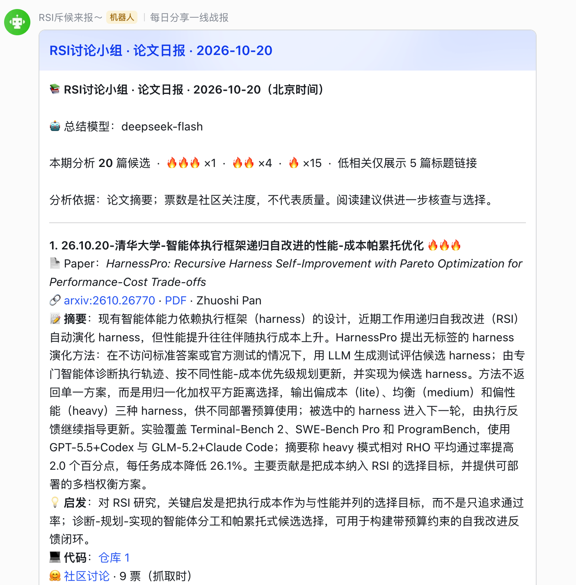

<div align="center">


# daily-paper-radar

**围绕你关注的研究主题，每天筛选并讲清相关论文，推送到飞书群。**

[](https://github.com/wjmZZZ/daily-paper-radar/actions/workflows/tests.yml)
[](https://github.com/wjmZZZ/daily-paper-radar/releases)
[](https://www.python.org/)
[](LICENSE)
[](#最快跑通本地运行)
[](docs/feishu-archive.md)

[English](README.md) · **简体中文**

</div>

告诉它你关注什么。每天从 **Hugging Face Daily Papers 和 arXiv** 收集新论文，由 LLM 按**你的研究主题**判断相关性并讲解方法，生成日报推送到飞书群（默认中文，可选英文）；也可以把完整版按日期追加到飞书文档，方便长期检索。

三种用法：**GitHub Actions 云端定时**（电脑关机也运行）、**Windows / macOS 本地定时**、**Claude Code / Codex skill**（随时手动分析或深读）。

先看 **[中文日报样例](examples/digest-full.zh.md)** · **[英文日报样例](examples/digest-full.en.md)**，无需配置密钥。样例为固定排版演示，实际飞书截图见 [截图说明](assets/screenshots/README.md)。

## 特点

- **按研究主题筛选。** 填写关注的关键词或研究方向，LLM 会按这个主题给每篇候选判断相关性并排序。两项一起填更聚焦，还可以补充阅读偏好。主题留空时才退回通用精选。
- **摘要能直接用来决定读不读。** 每篇论文给出问题、方法、贡献、现有证据、局限和阅读建议。默认基于摘要分析，不声称已经读完全文。
- **标题可读。** 统一为 `年月日-会议/期刊-一作机构中文简称-核心贡献`，缺失的会议或机构直接省略。
- **失败可恢复。** 单篇分析、待发批次和每个目标的投递记录都会落盘；重试时跳过已经成功的群，不重复分析。
- **可选来源筛选。** 只保留一作机构属于 QS 前 100 快照或团队白名单的论文；HTML 信息不足时回退 PDF 首页。
- **模型可替换，默认走谷时。** OpenAI 兼容接口与 Anthropic 原生接口共用三个环境变量；低峰分析默认开启，定时任务遵守配置的调用时段，是否有折扣取决于服务商，已生成的日报照常到点投递、不额外调用模型。

## 最快跑通：GitHub Actions

1. **Fork** 本仓库。
2. 打开你自己仓库的 **Actions** 标签，启用工作流。Fork 后 GitHub 默认禁用工作流。
3. 在 **Settings → Secrets and variables → Actions → Secrets** 添加 `LLM_BASE_URL`、`LLM_API_KEY`、`LLM_MODEL_NAME`、`FEISHU_WEBHOOK`。
4. 在 **Variables** 填写你关注的主题：`PAPER_KEYWORDS`（英文关键词）或 `PAPER_FOCUS`（研究方向）。它决定每天筛选哪些论文。`DAILY_ENABLED` 先不填。
5. 打开 **Actions → 每日论文推送 → Run workflow**：先运行 `preview` 并下载 `paper-preview` 检查内容，再运行 `all` 完成首次真实推送；成功后把 `DAILY_ENABLED` 设为 `true`。

配置关注主题、模型接口和飞书机器人后，即可启用定时任务。定时分析默认等待谷时（`LLM_OFFPEAK_ONLY=true`）以控制模型调用费用；日报生成后按**北京时间 09:30** 投递。GitHub 定时触发属于尽力而为，推送可能延迟，原因和处理见 [为什么有时不准时](docs/quickstart.md#为什么有时不准时)。

完整的菜单路径、飞书 Webhook 获取方式和每一步的预期结果，见 **[GitHub Actions 5 步跑通](docs/quickstart.md)**。

## 最快跑通：本地运行

需要 **Python 3.10+**。抓取和排版只用标准库；PDF 首页机构识别可选安装 `pypdf`。

```bash
git clone https://github.com/wjmZZZ/daily-paper-radar.git
cd daily-paper-radar
python3 scripts/init_config.py
python3 scripts/run_daily.py --check
python3 scripts/run_daily.py --dry-run --allow-peak
python3 scripts/run_daily.py
```

首次预览使用 `--allow-peak` 仅对本次放开高峰限制，可能增加费用，不修改定时设置。普通运行仍遵守错峰规则。

Windows 将 `python3` 换成 `python`。`init_config.py` 会生成 `.env` 和 `config/profile.json`，已有文件不会被覆盖。通过受控环境注入模型与飞书凭据，在 `config/profile.json` 调整 `keywords` 和 `sinks`。

需要每天自动运行时，Windows 使用 `scripts/install_task.ps1`，macOS 使用 `scripts/install_launchd.sh`。电脑需保持开机、联网和账户登录。完整步骤、三种模型后端、日志、升级与卸载见 **[本地部署](docs/local-deployment.md)**。

## 日报语言与离线预览

默认输出中文。本地在 `config/profile.json` 设置 `"digest_language": "en"` 切换英文，设为 `"zh"` 切回中文；GitHub Actions 在仓库 Variables 设置 `DIGEST_LANGUAGE` 为 `en` 或 `zh`。标题、摘要、启发、阅读建议与固定文案同步切换。自定义 `digest_title` 和模板按原样使用，请自行使用目标语言。

```bash
python3 scripts/render_demo.py
python3 scripts/render_demo.py --language en
```

离线演示不联网、不调用模型、不推送，结果写入 `state/demo/`。已有待发批次先完成，再切换语言；更改语言不会翻译旧日报，`publish` 和 `resend_bot` 也不会重新分析。

## 文档

| 内容 | 文档 |
| --- | --- |
| GitHub Actions 从零跑通 | [快速开始](docs/quickstart.md) · [English](docs/quickstart.en.md) |
| Windows / macOS 本地部署 | [本地部署](docs/local-deployment.md) · [English](docs/local-deployment.en.md) |
| 常见失败与处理 | [常见问题与排错](docs/troubleshooting.md) · [English](docs/troubleshooting.en.md) |
| Secrets、Variables 与手动操作 | [云端配置](docs/github-actions.md) · [English](docs/github-actions.en.md) |
| 北京时间规则、计费时段、完整变量表 | [调度与省钱](docs/scheduling.md) |
| 模型后端、多群推送、`.env` 规则 | [进阶配置](docs/advanced.md) |
| 一作机构与来源筛选 | [来源筛选](docs/source-screening.md) |
| 飞书文档归档 | [飞书文档归档](docs/feishu-archive.md) |

全部文档及中英文覆盖情况见 **[文档索引](docs/README.md)**。

## 日报长什么样

以下为已有部署的实际飞书截图（2026-10-20），新版栏目以当前代码和样例为准。页首主图为概念视觉，实际推送效果如下。



- 候选论文按 LLM 判断的相关性排序；🔥 表示主题相关程度，不代表论文质量。
- 中高相关论文逐篇展开中文摘要与启发；低相关论文默认只保留 5 条标题链接。
- 标题统一为 `年月日-会议/期刊-一作机构中文简称-核心贡献`，日期是北京时间收录日，缺失信息直接省略。
- 开头显示本批次实际调用的模型名称。
- 当天没有新论文时，默认不向群里发送空日报。

## 限制与隐私

社区票数表示关注度，不代表正确性；候选数量上限也可能漏掉相关论文。机构识别依赖可归属的作者元数据。重试能减少重复投递，但状态丢失或网络结果不确定时无法保证严格只发送一次。模型费用和服务可用性取决于你的服务商。

`.env`、`config/profile.json`、运行状态、日志和编辑器历史都已排除在 Git 之外。请不要提交真实凭据或 Webhook。公开仓库的 Actions 产物仍可能通过论文摘要体现关注方向。

## 参与贡献

欢迎提交问题、文档改进和聚焦的 Pull Request。请先阅读 [贡献指南](CONTRIBUTING.md)、[安全政策](SECURITY.md) 和 [行为准则](CODE_OF_CONDUCT.md)。

```bash
python3 -m unittest discover -s tests -v
```

单元测试不需要 API 密钥，也不会发送飞书消息。CI 覆盖 Windows、macOS、Ubuntu 与 Python 3.10 / 3.12。

## 许可证

[MIT](LICENSE)。
